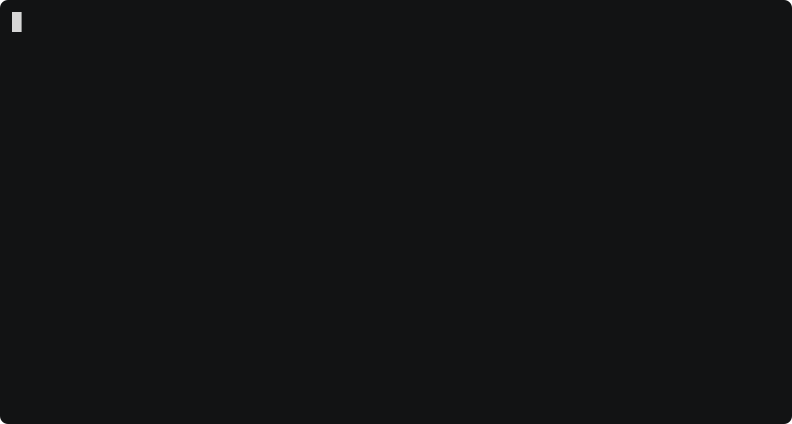
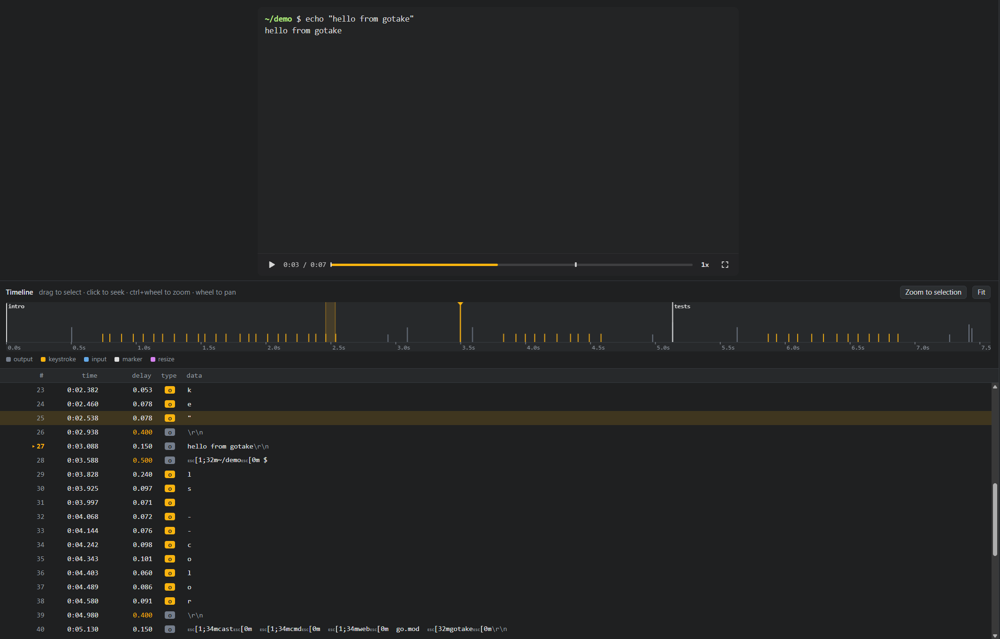

# go-take — record, edit and embed terminal sessions

Record terminal sessions, edit them, and embed them on web pages. Written in Go.



- **Recorder**: runs your shell (or any command) in a PTY and streams events to a file.
- **Editable format**: recordings are saved as `.take`, a line-based text format made for editing by hand. Typed
  commands are one readable line, delays are relative, and escape codes look like `\e[32m`.
  [asciicast](https://docs.asciinema.org/manual/asciicast/v3/) (`.cast`, v2 and v3) is supported for import and export.
- **Embeddable web player**: a single `gotake-player.js` (built on xterm.js).
- **Web editor**: delete, stretch, even out typing, and inject commands and output, with undo/redo and live preview.

## Install

Download a prebuilt binary from [Releases](https://github.com/oktalz/go-take/releases), or install with Go:

```sh
go install github.com/oktalz/go-take/cmd/gotake@latest
```

This installs the `gotake` binary.

Or run via the multi-arch container image on GHCR:

```sh
docker run --rm -v "$PWD:/work" ghcr.io/oktalz/go-take export -f svg demo.take
docker run --rm -v "$PWD:/work" -p 8080:8080 ghcr.io/oktalz/go-take edit -addr :8080 demo.take
docker run --rm -v "$PWD:/work" -p 8080:8080 ghcr.io/oktalz/go-take serve -addr :8080 .
```

## Record and play

```sh
gotake rec                        # records $SHELL to out.take; type exit (or Ctrl-D) to finish
gotake rec demo                   # records to demo.take
gotake rec -i -c "htop" top.take  # -i also records keystrokes, -c runs a command
gotake play -s 2 demo.take        # space pauses, q quits
gotake play -from intro -to tests # play only from marker "intro" to marker "tests"
gotake info demo.take
```

Every command that takes a FILE uses `out.take` when none is given, so `gotake rec`, `gotake play` and `gotake edit`
work on what a plain `gotake rec` recorded. A name without an extension gets `.take` added, so `gotake play demo` plays `demo.take`.

The `exit` (or Ctrl-D) that ends a recording is removed automatically, so it ends on the last prompt. Pass
`-keep-exit` to keep it. For older recordings, use `gotake trim-exit FILE` or *Remove trailing exit* in the editor's
right-click menu.

## Record from a script

`gotake run` records a session from a script instead of your typing, so a demo can be made again whenever what it
shows changes, for example in CI:

```sh
gotake run demo.script            # records to demo.take; -o OUT, -q to not show it while recording
```

```text
size 80x20
shell "bash --norc --noprofile"
hide                              # set up without recording it
send "PS1='$ '\r"
wait '^\$ $'
show                              # the prompt stays on screen
type "ls --color"                 # typed a character at a time (typing 80ms 40ms sets the speed)
enter
wait '^\$ $'                      # wait for output matching a regular expression
marker files
sleep 2
```

Steps are `type`, `send` (all at once), keys (`enter`, `tab`, `up`, `ctrl+c`, … with an optional count), `sleep`,
`wait REGEXP [TIMEOUT]`, `hide` / `show`, `marker` and `caption`. Strings use the `.take` quoting; `'single quotes'` take text
as it is, which suits regular expressions. `gotake run -h` lists everything.

## The .take format

A recording made with `gotake rec demo` (the `.take` extension is added for you) looks like this:

```
gotake 1
term 80x24 xterm-256color
title "demo"

out    0.5 "\e[1;32m~/demo\e[0m $ "
type   0.24 "ls --color" 0.097 0.071 0.072 0.076 0.098 0.101 0.06 0.086 0.091
out    0.4 "\r\n"
out    0.15 "\e[1;34mcast\e[0m  go.mod\r\n"
marker 0 "tests"
```

- Each line is one event: a keyword, the delay in seconds since the previous event (`80ms` and `1.5s` work too),
  then its data. Keywords are `out`, `in`, `resize`, `marker`, `exit`, `caption` and `type`.
- **`caption 1 "Now we deploy"`** shows text in a box at the bottom of the terminal until the next caption; a
  `caption` without text hides it. The player and GIF, SVG and PNG exports draw captions; other asciicast players
  skip them.
- **`type`** is text typed at the prompt: the delay before the first key, the text, then the delay before each
  following key, or `every=0.08` for a steady speed. You can change the text without touching the delays. New
  characters get the average delay, and delays left over are ignored.
- **`wait 2`** on its own line adds a 2 second pause before the next event.
- Strings use `\e`, `\r`, `\n`, `\t`, `\\`, `\"`, `\xHH` and `\uXXXX` escapes; `'single quoted'` strings are taken as
  they are. `#` starts a comment, but comments are not kept when gotake saves the file.
- `cell 9x18` in the header is the size of a terminal cell in pixels, recorded when the terminal reports it, so
  images are drawn at the size they had.

A `.take` file keeps everything an asciicast file holds, so converting in either direction loses nothing:

```sh
gotake convert old.cast new.take     # import from asciinema
gotake export -f cast demo.take      # export asciicast v3 -> demo.cast (-f v2 for older tools)
```

Commands work on `.cast` files too. A file named `*.cast` is read and saved as asciicast, and anything else is
saved as `.take`.

## Edit in the browser

```sh
gotake edit demo.take
```



- Select events by clicking or dragging rows in the event list (dragging past the edge scrolls), or by dragging
  on the timeline. Shift/Ctrl+click and Shift+arrows/PgUp/PgDn/Home/End extend the selection.
- **Selection**: delete, duplicate, merge, split lines, play selection.
- **Timing**: stretch ×N, set the section length, set each delay, cap pauses, insert a pause.
  With nothing selected, these apply to the whole recording.
- **Even out typing**: gives keystrokes a uniform delay plus optional jitter. The pause before each burst of typing is kept.
- **Find & replace** (Ctrl+F): change text in every output event at once, for example a shell prompt such as
  `zlatko@WSL:~/src/project$`. Matching uses the visible text, so it works even when the shell colors parts of the
  prompt. Matches are counted live as you type, Enter jumps to the next one, and Replace all is one undo step.
  Tick *mask* to replace matches with `*` instead, keeping the layout; *Find secrets* finds common tokens, keys and
  `password=...` values to mask.
- **Insert window** (right-click → Insert, or Ctrl+I): a floating, draggable window opened where you clicked. Its
  tabs insert a typed command with output, raw output, a marker or a pause, before or after the selection. If the
  screen already shows a prompt at that point, the command is typed at it and the same prompt is printed again
  afterwards. Ctrl+Enter inserts and Esc closes.
- **Inject command**: types a command character by character after a prompt, then prints its output line by line.
- **Theme**: color pickers for text, background and the 16 palette colors, a few presets (Dracula, Solarized dark,
  Light), and a transparent background. The theme is saved in the recording and used by the player and by
  GIF/SVG/PNG export. A transparent GIF stores every frame whole, so it is several times larger.
- **Insert**: raw output (with `\r\n`, `\e[31m` escapes), markers (chapters shown on the player's progress bar) or a
  clear screen.
- **Event**: edit a single event's delay, type and data. Double-click a delay cell to edit it inline.
- **Right-click menus** on event rows, the timeline, the preview and everywhere else. They cover play from here,
  set delay, speed up or slow down, insert pause or marker, cut/copy/paste, find similar text, zoom, playback speed
  and copying selected or whole screen text. Submenus and keyboard navigation work, and the Menu key or Shift+F10 opens the menu for the
  selection.
- Ctrl+X / Ctrl+C / Ctrl+V cut, copy and paste events. Copied events go to the system clipboard as asciicast lines,
  so you can paste them into another recording's editor or a text file.
- Undo with Ctrl+Z, redo with Ctrl+Shift+Z, save with Ctrl+S.

## Edit from the CLI

```sh
gotake cut     -from 0:12 -to 0:20 demo.take
gotake stretch -from 5 -to 9 -factor 0.5 demo.take
gotake speed   -factor 1.5 demo.take
gotake idle    -max 1 demo.take
gotake typing  -delay 0.07 -jitter 0.02 demo.take
gotake inject  -at 0:30 -cmd "kubectl get pods" -output-file pods.txt demo.take
gotake pause   -at 0:42 -seconds 2 demo.take
gotake marker  -at 0:42 -label "deploy" demo.take
gotake caption -at 0:42 -text "Now we deploy" demo.take
gotake replace -find 'zlatko@WSL' -replace 'demo' demo.take
gotake redact  demo.take          # mask tokens, keys and password=... values with *
```

`replace` matches visible text and keeps color codes. Replacing the user@host and the path separately keeps each
part's color. Add `-raw` to also match inside escape sequences, such as the window title, and `-regex` for regular
expressions (`$1` works in `-replace`).

`redact` replaces each character of a match with `*`, so nothing shifts. Without `-pattern` it looks for tokens of
well-known services (GitHub, GitLab, AWS, Slack, Stripe, Google, `sk-` API keys), JSON web tokens and the value after
keys such as `password=` or `api_key:`. In your own `-pattern`, a `(?P<secret>...)` group masks only that part.
While recording with `rec -i`, keystrokes typed with terminal echo off, such as passwords, are not stored.

Each command modifies FILE in place unless you pass `-o OUT`. `-from`, `-to` and `-at` take seconds (`12.5`),
minutes:seconds (`1:02.5`) or a marker label, for example `gotake cut -from intro -to tests`.

## Export

```sh
gotake export -o demo.gif demo.take                  # animated GIF
gotake export -f svg -window demo.take               # animated SVG with a title bar -> demo.svg
gotake export -o demo.html -autoplay demo.take       # one self-contained HTML page with the player
gotake export -o demo.mp4 -window demo.take          # H.264 video (.webm for VP9); needs ffmpeg
gotake export -o poster.png -at 0:12 demo.take       # one frame as PNG (svg-frame for SVG)
gotake export -f txt demo.take                       # plain-text transcript
gotake export -f v2 -o old.cast demo.take            # asciicast v2 for older tools
gotake export -o part.gif -from 0:10 -to 0:25 demo.take
gotake export -o part.gif -from intro -to tests demo.take   # between two markers
```

Common flags: `-speed`, `-idle` (cap pauses), `-fps`, `-font-size`, `-font`, `-padding`, `-window`, `-no-cursor`.
The format comes from `-f` or the `-o` extension.

`-window` adds a title bar in the style of the system you export on: a GNOME header bar on Linux, the minimize,
maximize and close buttons on Windows (WSL included), or the colored buttons on macOS. Pick one with
`-window=linux`, `-window=windows` or `-window=mac`. The bar shows the recording's title (or its command) and takes
its colors from the theme.

GIF and PNG are rendered in Go with the built-in Go Mono font and need nothing installed. Animated SVG is usually
smaller and stays sharp at any size, but uses the viewer's monospace font. MP4 and WebM are drawn the same way in
full color and encoded by [ffmpeg](https://ffmpeg.org), which must be in `PATH`; they are much smaller than a GIF
for long sessions and are what chat and social apps take. A section exported with `-from` starts on the same screen
it had in the full recording.

### Fonts in GIF and PNG

- Box drawing (`┌─┐ ╭─╮ ═╬═ ┏━┓`), block elements (`▁▂▃█ ▏▌ ░▒▓`), braille (`⣿⠋`, btop graphs, spinners) and powerline
  separators (``) are drawn in code, not taken from a font, so lines join across cells without gaps.
- `-font FILE` (TTF, OTF or TTC; repeat for more) uses your own font, for example your terminal's Nerd Font. Its bold
  and italic files are found next to it (`-Regular` becomes `-Bold`, `-Italic`, ...). Go Mono covers what it lacks.
  Set `GOTAKE_FONT=/path/a.ttf:/path/b.ttf` to use fonts by default, including for exports from the editor.
- Characters none of these fonts have (`❯ ✓ ▽`, CJK, monochrome emoji) are looked up in the installed fonts with
  fontconfig (`fc-match`), so they do not show as boxes. Wide glyphs are shrunk to fit a cell. Pass
  `-no-system-fonts` for output that is the same on every machine. Without fontconfig (macOS, Windows) this step
  is skipped; use `-font` there.

```sh
gotake export -o demo.gif -font ~/.local/share/fonts/JetBrainsMonoNerdFont-Regular.ttf demo.take
```

In the editor, use **Export ▾** in the top bar or the Export panel for options. Right-click a selection for
*Export selection as*, and right-click the preview for *Save frame as* (PNG, SVG or text at the playhead).

## Embed on a web page

```html
<script src="gotake-player.js"></script>
<div data-gotake-src="demo.take" data-autoplay data-loop data-idle-time-limit="2"></div>
```

Get the script with `gotake player-js > gotake-player.js`, or serve it together with a folder of recordings:

```sh
gotake serve -addr :8080 ./recordings   # gallery at /, script at /gotake-player.js, .take and .cast files at /casts/
```

Data attributes: `data-autoplay`, `data-loop`, `data-speed`, `data-idle-time-limit`, `data-start-at`, `data-stop-at`,
`data-poster`, `data-font-size`, `data-fit="width|none"`, `data-controls="false"`.

Start, stop and poster take seconds or a marker label, so one recording can be embedded several times, one chapter
each:

```html
<div data-gotake-src="demo.take" data-start-at="intro" data-stop-at="tests"></div>
```

Playback pauses at the stop point. Press play to continue past it, or add `data-loop` to repeat the section.

JavaScript API:

```js
const p = await GoTakePlayer.create('#el', 'demo.take', { speed: 1.5, startAt: 'intro', stopAt: 'tests' });
p.on('marker', m => console.log(m.label));
p.on('stop', () => {});   // paused at stopAt
p.on('ended', () => {});
p.seek(10); p.play(); p.pause(); p.setSpeed(2);
```

[examples/player.html](examples/player.html) shows all of this on one page: run `gotake serve examples` (or
`task serve`) and open the page from the gallery.

Keyboard (when focused): space play/pause, ← → seek 5s, `.` step, `[` `]` previous/next marker, `0`–`9` jump, `f` fullscreen,
Ctrl+C copies text selected with the mouse (also `p.selectedText()` and `p.copySelection()`).

The player loads xterm.js from jsDelivr unless `window.Terminal` already exists. To self-host it, load xterm yourself first or pass `xtermBase`.

## Development

Uses [Task](https://taskfile.dev/). Install it with `make install-task`. Go tools are pinned in `taskfile-tools.yml`.

```sh
task build          # ./gotake
task test           # gotestsum, -race
task lint           # go vet, revive, staticcheck, betteralign
task format         # go fix, betteralign -apply, gofumpt
task ci             # tidy, format, licenses, lint, test, govulncheck
task play           # play examples/demo.take (or: task play -- my.take)
task edit           # open the editor on the demo (or: task edit -- my.take)
task serve          # gallery of examples/
task docs           # export the README demo (docs/demo.svg) from examples/demo.take
```

## Layout

| path | |
|---|---|
| `cast/` | `.take` and asciicast read/write and all edit operations, shared by the CLI and the editor |
| `record/` | PTY recorder and script runner (`gotake run`) |
| `play/` | terminal playback |
| `export/` | GIF, PNG, SVG, HTML and text export, using the vt10x terminal emulator |
| `web/` | editor server and API, gallery server, embedded static assets |
| `web/static/gotake-player.js` | the embeddable player, with no build step |
| `version/` | build version info and startup logo |
| `cmd/gotake/` | CLI |
| `examples/demo.take` | demo made only from `gotake inject` commands |
| `docs/demo.svg` | the README demo, made with `task docs` |
| `examples/editor.png` | screenshot of the web editor, shown in this README |
| `examples/player.html` | web player examples: data attributes, chapters by marker, JavaScript API |

## License

[MIT](LICENSE). The embeddable player (`gotake-player.js`) carries the license in its header comment, so a copy on
your site or inside an exported HTML page only needs that comment kept. xterm.js, loaded by the player, is also MIT.
